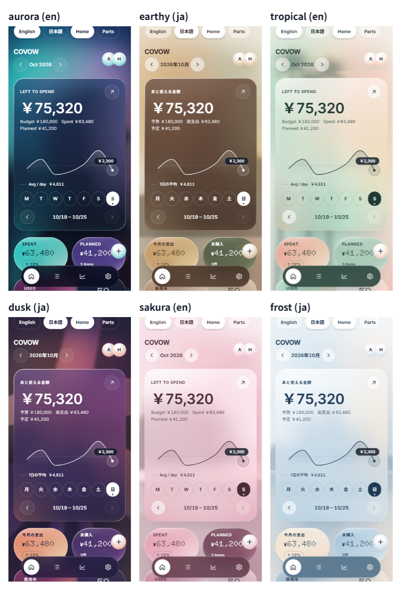

# COVOW

**Decide together. Spend better.**

A small web app for couples and households of up to four people to share
what they plan to buy, what they actually spent, and the monthly budget.
Built for phones, installable as a PWA, and runs entirely on Cloudflare.



## Features

- **Purchase plans** — add what you intend to buy, decide together, then mark it bought.
  Buying a plan records the expense in the same step.
- **Expenses and budget** — monthly budget, "left this month", daily spending,
  categories, and an over-budget notice before you confirm.
- **Insights** — overview, six-month trend, category share and per-member share.
- **Shared space** — one space for 1–4 people, joined with a one-time invite link (72 hours).
- **Sign in with Google**, or try it for 24 hours without an account (sample data,
  deleted automatically).
- **Guided tour** ("Let's Try") that walks through the main actions.
- **Three display languages** — English, Japanese, and *Mix* (English layout with
  Japanese for the sentences that explain money). Japanese text breaks at phrase
  boundaries with [BudouX](https://github.com/google/budoux).
- **Six themes** — Aurora, Earthy, Tropical, Dusk, Sakura, Frost (all checked for
  WCAG AA contrast).

## Tech

| Area | Choice |
|---|---|
| Hosting | Cloudflare Workers with static assets (single Worker for the SPA and the API) |
| Database | Cloudflare D1 (SQLite) with Drizzle ORM and SQL migrations |
| API | Hono, validated with Zod |
| Front end | React 19, Vite, TanStack Router and Query, Tailwind CSS v4, Motion |
| Auth | Google OAuth 2.0 / OpenID Connect with [oauth4webapi](https://github.com/panva/oauth4webapi) (PKCE, state, nonce); sessions stored hashed in D1, `__Host-` cookies |
| Tests | Vitest with `@cloudflare/vitest-plugin` (runs inside the Workers runtime) |

Design notes: money is calculated only in `src/shared/money/`, and access is
checked in two places only — `src/server/middleware/require-member.ts` and the
`src/server/repo/` layer. Requests that change data must come from the app's own
origin.

## Run locally

Requirements: Node.js 22 or later.

```bash
npm install
cp .dev.vars.example .dev.vars   # then fill in the Google OAuth values
npm run db:migrate:local
npm run dev                      # http://localhost:5173
```

Setting up the Google OAuth client is described step by step in
[docs/GOOGLE_SETUP.md](docs/GOOGLE_SETUP.md) (Japanese). Without it you can still
use "Try without signing in".

```bash
npm run check   # type check, lint and all tests
```

## Deploy

See [docs/DEPLOY.md](docs/DEPLOY.md). In short: create the production D1
database, apply migrations, register three secrets with `wrangler secret put`,
build with `CLOUDFLARE_ENV=production`, then `wrangler deploy`. The GitHub
Actions workflow `Deploy` does the build and deploy when run by hand.

## License

[MIT](LICENSE)
