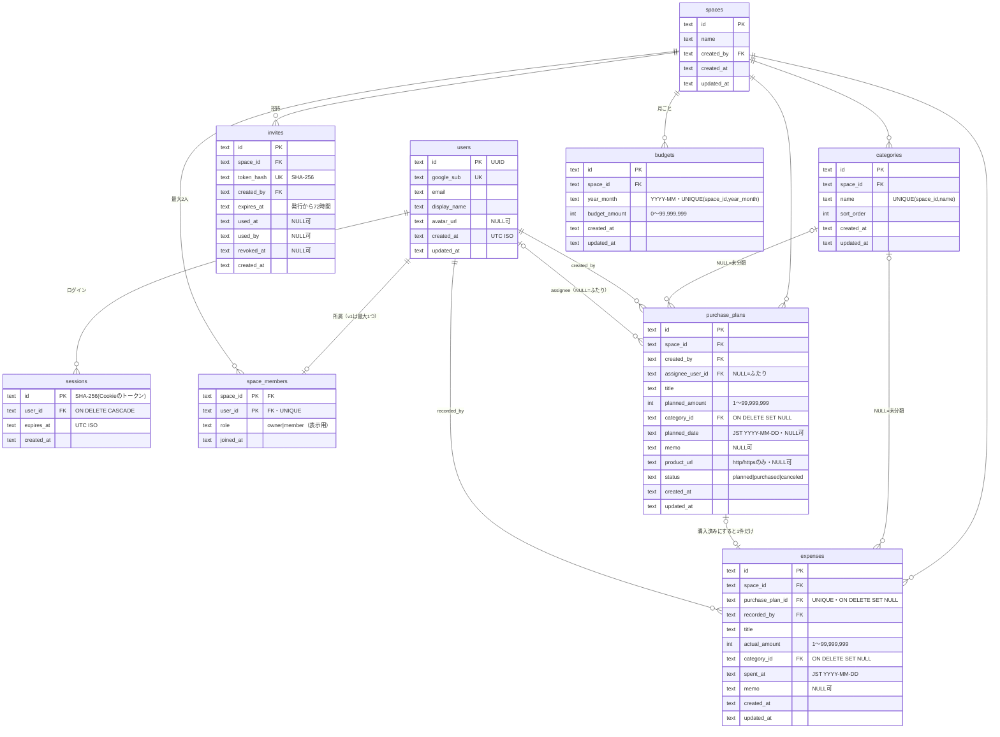

# COVOW フェーズ0 — 調査と計画

作成日: 2026-10-25（指示書 v2 に基づく）

---

## 0. 事前確認の結果

| 項目 | 状況 | 対応 |
|---|---|---|
| 作業フォルダ | `01_共通\covow-app` を作成（いまは `docs/` だけ） | 以降はこの中だけで作業する |
| Node.js / npm | v24.21.0 / 11.19.0 | そのまま使う（パッケージマネージャは npm） |
| git | 2.55.0 導入済み | フェーズ1で `git init` |
| gh CLI | 2.102.0 導入済み | ログイン状態はフェーズ9の直前に確認する |
| wrangler | グローバルには未導入 | devDependency に入れて `npx wrangler` で使う（最新 4.152.0） |
| 参考：献立アプリ | フォルダには計画書（`PLAN.md`）と指示書だけで、コードはなし | 計画の書き方・OneDrive 対策の考え方を参考にした |

### 0.1 公式ドキュメント・npm で確認したこと（2026-10-25 時点）

**指示書のスタックから変える必要があるもの（✋承認が必要）**

1. **Arctic は 2026年7月に非推奨（deprecated）になっています。**
   - 公式サイト（arctic.pilcrowonpaper.com）に「Arctic was deprecated in July 2026」とあり、npm でも deprecated 扱いです。最終版は 3.7.0（2025-05）で、今後更新されません。作者は「自分で実装すること」を勧めていて、置き換え用のサンプルコードを公開しています。
   - **提案：`oauth4webapi`（panva 作）に置き換える。**
     - 依存ゼロ、Cloudflare Workers 対応と明記、OpenID の Relying Party 認証（Basic / FAPI）を取得済みで、継続的にメンテナンスされている（最新 3.8.8）。
     - PKCE・`state`・ID トークンの検証（`iss` / `aud` / `exp` / `nonce`）をライブラリ側で正しく行えるので、自作より安全側に倒せる。
   - 代わりの案：(b) 作者のサンプルを元に自作（Web Crypto ＋ fetch、150行程度。ID トークンは TLS で Google から直接受け取るので署名検証を省略できるが、クレームの検証は自分で書く）、(c) 非推奨と承知のうえで Arctic 3.7.0 を使う（非推奨）。
2. **`@cloudflare/vitest-pool-workers` は `@cloudflare/vitest-plugin` に名前が変わりました**（2026-08-19 の変更履歴。旧パッケージは deprecated で更新されない）。
   - API は同じ。`@cloudflare/vitest-plugin` 1.4.7 は Vitest `^4.1 || ^5` に対応している。**新しい名前のほうを使う。**

**そのまま使えることを確認したもの**

- **Workers 静的アセット＋SPA：** `wrangler.jsonc` の `assets.not_found_handling: "single-page-application"` と `assets.run_worker_first: ["/api/*"]` で、`/api/*` だけを Worker（Hono）に、それ以外は SPA の `index.html` に送れる。Vite プラグインを使う場合は `assets.directory` を書かない（ビルド出力を自動で使う）。`vite build` で出力用の `wrangler.json` が作られ、それがデプロイに使われる。`compatibility_date` は作成日の日付にする。
- **`@cloudflare/vite-plugin` 1.65.0：** Vite 6〜8 と wrangler `^4.152.0` に対応。ローカルの D1 を含めて `vite dev` で動く。
- **D1 の `batch()`：** 「バッチの文は SQL トランザクションで、1文でも失敗すると全体を取り消す」と明記されている（指示書 7.4・7.5 の前提どおり）。
- **D1 の外部キー：** 既定で強制される（`PRAGMA foreign_keys = on` 相当で、変更できない）。`ON DELETE SET NULL` が使える。
- **D1 マイグレーション：** `drizzle-kit generate` で SQL を作り、`wrangler d1 migrations apply`（`--local` / `--remote`）で適用する。Drizzle がフォルダ入れ子の形式で出力する版の場合は、`migrations_pattern` で読み込める（2026-05 追加）。どちらの形式になるかはフェーズ1で、入れた版で確認する。
- **テスト用の D1：** `readD1Migrations()` でマイグレーションを読み、セットアップファイルで `applyD1Migrations()` を呼ぶ。保存領域はテストファイルごとに分かれる。
- **主なライブラリの最新版：** Vite 8.3 / React 19.3 / Hono 4.13 / Drizzle ORM 0.45（drizzle-kit 0.31）/ TanStack Router 1.170・Query 5.104 / Tailwind CSS 4.3 / Motion 14.6 / Zod 4.6 / vite-plugin-pwa 2.0（Vite 8 対応）/ `@vitejs/plugin-react` 6.1（Vite 8 専用）。
- **フォント：** Doto は `@fontsource/doto` があり、ライセンスは SIL OFL 1.1（自前配信して問題ない）。英数字は `@fontsource-variable/inter`。

---

## 1. ディレクトリ構成

```
covow-app/
├─ docs/                         # 本計画書など
├─ wrangler.jsonc                # Worker 名、assets、D1（開発用 / 本番用を分ける）
├─ vite.config.ts                # cloudflare(), react(), tailwindcss(), tanstackRouter(), VitePWA()
├─ vitest.config.ts              # projects: unit（Node） / workers（@cloudflare/vitest-plugin）
├─ drizzle.config.ts
├─ tsconfig.json                 # strict。app / server / node 用に分ける
├─ eslint.config.js
├─ .dev.vars.example             # GOOGLE_CLIENT_ID / GOOGLE_CLIENT_SECRET / APP_ORIGIN（値は書かない）
├─ .github/
│  ├─ workflows/ci.yml           # PR と push：型チェック・リンター・テスト・ビルド
│  ├─ workflows/deploy.yml       # main への push：テスト通過後にマイグレーション＋wrangler deploy
│  └─ dependabot.yml
├─ migrations/                   # drizzle-kit が作る SQL（＋トリガー用のカスタム SQL）
├─ scripts/
│  └─ seed-local.ts              # デモデータ（--local 専用。--remote は拒否する）
├─ public/                       # PWA アイコンなど
├─ src/
│  ├─ shared/                    # ★フロントとサーバーの両方で使う
│  │  ├─ money/                  # ★金額計算の純粋関数（ここ以外で計算しない）
│  │  │  ├─ amount.ts            #   入力の正規化（全角・カンマ・¥）、表示用フォーマット、短縮表示（12.8万）
│  │  │  ├─ month.ts             #   予定・支出がどの月に入るか
│  │  │  ├─ summary.ts           #   実支出・予定額・残額・使用率・先月比
│  │  │  ├─ analytics.ts         #   カテゴリ別・推移・メンバー別・予定と実績の差
│  │  │  └─ *.test.ts
│  │  ├─ date/jst.ts             # 日本時間の「今日」「今月」、月の UTC 範囲、週（月曜はじまり）
│  │  ├─ schemas/                # Zod（金額、予定、支出、予算、カテゴリ、プロフィール、スペース）
│  │  └─ constants.ts            # 上限値、初期カテゴリ
│  ├─ server/
│  │  ├─ index.ts                # Hono アプリ（export type AppType）
│  │  ├─ db/schema.ts            # Drizzle スキーマ
│  │  ├─ middleware/
│  │  │  ├─ security-headers.ts  # CSP・HSTS など
│  │  │  ├─ origin-check.ts      # 変更系 API の Origin 確認（CSRF 対策）
│  │  │  ├─ session.ts           # Cookie → セッション → ユーザー
│  │  │  └─ require-member.ts    # ★所属スペースをサーバーで決めて c.var.spaceId に入れる
│  │  ├─ auth/                   # Google OAuth、セッションの発行・延長・削除、トークンのハッシュ化
│  │  ├─ repo/                   # ★スペースで絞り込むクエリ関数（spaceId を必ず引数に取る）
│  │  └─ routes/                 # auth, me, space, invites, categories, budgets, plans, expenses, summary, analytics
│  └─ app/
│     ├─ main.tsx                # MotionConfig reducedMotion="user"、QueryClient、Router
│     ├─ api.ts                  # hc<AppType> クライアント
│     ├─ routes/                 # TanStack Router（ファイルベース）
│     ├─ features/               # 画面ごとのデータ取得フック（home, plans, expenses, analytics, settings, onboarding）
│     ├─ components/
│     │  ├─ glass/               # HeroGlassCard, MetricPill, AddPill, GlassSheet, FloatingNav, TabChips …
│     │  ├─ charts/              # SpendCurve, DayChips, WeekNavigator, CategoryBars（d3-shape・d3-scale）
│     │  └─ ui/                  # AmountDisplay, StatusBadge, EmptyState, LoadingSkeleton, ConfirmDialog, FormField …
│     └─ styles/                 # tokens.css（色・余白・角丸・影・ぼかし）、glass.css、grain（SVG データ URI）
└─ test/                         # Workers 環境の結合テスト
   ├─ helpers/                   # テスト用ユーザー・セッション・スペースを作る関数
   ├─ auth.test.ts / permissions.test.ts / integrity.test.ts / invites.test.ts / validation.test.ts
   └─ apply-migrations.ts
```

方針：
- **見た目の部品**（`components/`）は props を表示するだけ。データ取得は `features/`、計算は `shared/money/` に置く。
- **権限は `require-member.ts` と `repo/` の2か所だけで守る。** ルートの中で SQL を直接書かない。

---

## 2. DB スキーマ

### 2.1 ER 図



### 2.2 制約・インデックス

| 対象 | 内容 | 目的 |
|---|---|---|
| `users.google_sub` | UNIQUE | 同じ Google アカウントで2人分作らない |
| `space_members.user_id` | UNIQUE | v1 は1人1スペース |
| `space_members` | **トリガー：INSERT 時に同じスペースが2人以上なら `RAISE(ABORT)`**（提案） | 2人上限を API に加えて DB でも保証する。同時参加でも3人目が入らない |
| `invites.token_hash` | UNIQUE | |
| `categories(space_id, name)` | UNIQUE | |
| `purchase_plans` | `CHECK (planned_amount BETWEEN 1 AND 99999999)`、`CHECK (status IN (...))` | |
| `expenses.purchase_plan_id` | UNIQUE（NULL は複数可）、FK `ON DELETE SET NULL` | **二重計上を DB で防ぐ** |
| `expenses` | `CHECK (actual_amount BETWEEN 1 AND 99999999)` | |
| `budgets(space_id, year_month)` | UNIQUE、`CHECK (budget_amount BETWEEN 0 AND 99999999)` | |
| 日付の形式 | `CHECK (planned_date GLOB '[0-9][0-9][0-9][0-9]-[0-9][0-9]-[0-9][0-9]')` など | 形式の崩れたデータを入れない |
| インデックス | `purchase_plans(space_id, status, planned_date)`、`purchase_plans(space_id, created_at)`、`expenses(space_id, spent_at)`、`categories(space_id, sort_order)` | 月の集計と一覧 |

- ID は `crypto.randomUUID()`。
- 将来カテゴリ別予算を足すときは、`budgets` に NULL 可の `category_id` を追加し、UNIQUE を `(space_id, year_month, category_id)` に変える（NULL＝全体予算）。いまの設計のまま拡張できる。
- 集計値は保存しない。毎回 `shared/money` で計算する。

### 2.3 整合性が必要な処理（`db.batch()` の中身）

D1 の `batch()` は1文でも失敗すると全体が取り消されますが、**「更新件数が 0 件」は失敗ではない**ので、後ろの文が条件を満たさないと動かないように書きます。

**購入済みにする（7.4）**
```sql
-- 1) 未購入のときだけ購入済みにする
UPDATE purchase_plans SET status='purchased', updated_at=?
 WHERE id=? AND space_id=? AND status='planned';
-- 2) 「購入済みになっている予定」があるときだけ支出を作る
INSERT INTO expenses (id, space_id, purchase_plan_id, recorded_by, title, actual_amount, category_id, spent_at, memo, created_at, updated_at)
SELECT ?, space_id, id, ?, title, ?, category_id, ?, NULL, ?, ?
  FROM purchase_plans WHERE id=? AND space_id=? AND status='purchased';
```
- 2回目の送信：1) は 0 件、2) は UNIQUE 違反 → **全体が取り消される** → API は 409「すでに購入済みです」。
- キャンセル済み：1) も 2) も 0 件 → 何も変わらない → API は 409 を返す。
- 別スペースの ID：0 件 → 404。

**未購入に戻す（7.5）**
```sql
DELETE FROM expenses WHERE purchase_plan_id=? AND space_id=?;
UPDATE purchase_plans SET status='planned', updated_at=? WHERE id=? AND space_id=? AND status='purchased';
```

**招待で参加する**：参加の INSERT（招待が有効なときだけ行が入る `INSERT … SELECT … FROM invites WHERE token_hash=? AND used_at IS NULL AND revoked_at IS NULL AND expires_at>?`）と、招待を使用済みにする UPDATE を1回の batch で行う。2人上限はトリガーで止める。

**スペース作成**：`spaces`・`space_members`（owner）・初期カテゴリ8件を1回の batch で作る。

---

## 3. 金額計算の設計（`src/shared/money`）

- 入力：その月の予算（ない場合は `null`）、予定の配列、支出の配列、基準日。出力：実支出・予定額・残額・使用率など。**DB にも画面にも依存しない純粋関数**にする。
- 月の判定：
  - 支出 → `spent_at` の月
  - 予定 → `planned_date` の月。空なら `created_at`（UTC）を日本時間に直した月
  - 日本時間は夏時間がないので、UTC＋9時間で計算する。`Intl` のタイムゾーン指定にも頼れるが、テストで固定しやすいようにする。
- API は「その月に入りうる行」を範囲で取り出し（例：`planned_date` がその月、または `planned_date IS NULL AND created_at` がその月の UTC 範囲）、**最終的な振り分けと計算は純粋関数が行う**（取り出しの条件がずれても計算は正しく保つ二重の安全策）。
- 予算が未設定 → 残額・使用率は `null`（画面は「未設定」）。0 円予算は「設定済みで 0 円」として扱う（使用率は計算できないので「—」表示）。
- 表示は `Intl.NumberFormat('ja-JP', { style: 'currency', currency: 'JPY' })`。ピルの短縮表示（`12.8万`）は切り捨てで、正確な値は `aria-label` に入れる。

---

## 4. API 一覧

すべて `/api` 配下。🔒＝ログイン必須、👥＝スペース所属必須（`requireMember`）。変更系（POST / PATCH / PUT / DELETE）は全部 `Origin` を確認する。入力は Zod（フロントと共通のスキーマ）で検証する。

### 認証・自分
| メソッド | パス | 内容 |
|---|---|---|
| GET | `/api/auth/google` | `state`・PKCE の値・`nonce` を短命の HttpOnly Cookie（10分）に入れて Google へリダイレクト。`?next=` は自サイト内のパスだけ受け付ける |
| GET | `/api/auth/google/callback` | `state` を照合 → トークン交換 → ID トークン検証 → ユーザー作成／更新 → セッション発行 → 画面へ |
| POST | `/api/auth/logout` | 🔒 DB のセッションを削除し、Cookie を消す |
| GET | `/api/me` | 🔒 自分の情報と、所属スペース（なければ `null`） |
| PATCH | `/api/me` | 🔒 表示名の変更 |

### スペース・招待
| メソッド | パス | 内容 |
|---|---|---|
| POST | `/api/space` | 🔒 スペース作成（未所属のときだけ）。初期カテゴリを入れる |
| GET | `/api/space` | 👥 スペース名とメンバー |
| PATCH | `/api/space` | 👥 スペース名の変更 |
| DELETE | `/api/space/members/:userId` | 👥 パートナーをスペースから外す（確認ダイアログあり） |
| POST | `/api/space/leave` | 👥 スペースから抜ける |
| POST | `/api/space/invite` | 👥 招待リンクを発行（古いリンクは取り消す）。トークンはこの応答でだけ返す |
| GET | `/api/space/invite` | 👥 有効な招待があるか・期限（トークンは返さない） |
| DELETE | `/api/space/invite` | 👥 招待を取り消す |
| GET | `/api/invites/:token` | 招待の確認（有効か、スペース名、招待した人の表示名）。ログイン前でも見られる |
| POST | `/api/invites/:token/accept` | 🔒 参加を確定（未所属・有効・2人未満のときだけ） |

### カテゴリ・予算
| メソッド | パス | 内容 |
|---|---|---|
| GET | `/api/categories` | 👥 一覧（並び順） |
| POST | `/api/categories` | 👥 追加 |
| PATCH | `/api/categories/:id` | 👥 名前の変更 |
| PUT | `/api/categories/order` | 👥 並べ替え（ID の配列。楽観的更新を使ってよい唯一の操作） |
| GET | `/api/categories/:id/usage` | 👥 削除前の確認用：使っている予定・支出の件数 |
| DELETE | `/api/categories/:id` | 👥 削除（予定・支出は「未分類」になる） |
| GET | `/api/budgets?from=YYYY-MM&to=YYYY-MM` | 👥 月ごとの予算 |
| PUT | `/api/budgets/:yearMonth` | 👥 `{ amount, applyToFuture }`。過去の月は、その月を明示的に編集したときだけ変わる |

### 購入予定
| メソッド | パス | 内容 |
|---|---|---|
| GET | `/api/plans?month=&status=&q=&sort=` | 👥 一覧（月・状態・商品名・並べ替え） |
| GET | `/api/plans/:id` | 👥 詳細（購入済みなら紐づく支出と差額も） |
| POST | `/api/plans` | 👥 登録 |
| PATCH | `/api/plans/:id` | 👥 編集 |
| POST | `/api/plans/:id/purchase` | 👥 `{ actualAmount, spentAt }` 購入済みにする（2.3 の batch） |
| POST | `/api/plans/:id/unpurchase` | 👥 未購入に戻す（2.3 の batch） |
| POST | `/api/plans/:id/cancel` | 👥 キャンセル（未購入のときだけ） |
| POST | `/api/plans/:id/restore` | 👥 キャンセル済み → 未購入 |
| DELETE | `/api/plans/:id` | 👥 削除（購入済みなら支出は残り、ひも付けだけ外れる） |

### 支出
| メソッド | パス | 内容 |
|---|---|---|
| GET | `/api/expenses?month=` | 👥 一覧（「予定から」の印付き） |
| POST | `/api/expenses` | 👥 予定なしの支出を記録（`purchase_plan_id` は受け取らない） |
| PATCH | `/api/expenses/:id` | 👥 編集（予定から作られた支出の金額・日付も直せる） |
| DELETE | `/api/expenses/:id` | 👥 削除（予定から作られた支出の扱いは「6. 確認したいこと」③） |

### 集計・分析
| メソッド | パス | 内容 |
|---|---|---|
| GET | `/api/summary?month=YYYY-MM` | 👥 ホーム用：予算、実支出、予定額、残額、使用率、未購入の予定の件数、先月比、直近の予定3件、先月以前の未購入の件数 |
| GET | `/api/daily?from=YYYY-MM-DD&to=YYYY-MM-DD` | 👥 日別の実支出（`SpendCurve` 用。最大 31 日） |
| GET | `/api/analytics/overview?month=` | 👥 概要（予定と実績の差を含む） |
| GET | `/api/analytics/categories?month=` | 👥 カテゴリ別 |
| GET | `/api/analytics/trend?end=YYYY-MM&months=6` | 👥 月別推移と予算 |
| GET | `/api/analytics/members?month=` | 👥 ふたり（記録した人ごと。外れた人は「元メンバー」にまとめる） |

### 共通の応答ルール
- 未ログイン 401、未所属 403（`{ code: "NO_SPACE" }`）、別スペースの ID・存在しない ID は区別せず 404、状態の衝突（すでに購入済みなど）409、入力エラー 422（項目ごとのメッセージ）。
- エラー応答にスタックトレース・SQL を入れない。ログに金額・商品名・メールアドレス・トークンを出さない。

---

## 5. 画面一覧

スマホ（375px）基準。PC では中央に最大幅 480px。下部の `FloatingNav`：**ホーム / 予定 / 分析 / 設定**。

| ルート | 画面 | 主な部品・状態 |
|---|---|---|
| `/welcome` | COVOW の紹介（予定と実支出の違い） | 未ログイン時の入口 |
| `/login` | Google でログイン | 失敗時のエラー表示 |
| `/onboarding/space` | スペースを作る／招待リンクから参加する | |
| `/onboarding/budget` | 今月の予算を決める（スキップ可） | |
| `/onboarding/first-plan` | 最初の購入予定を追加（スキップ可） | |
| `/invite/$token` | 招待の確認 → ログイン → 参加を確定 | 期限切れ・使用済み・満員の表示 |
| `/` | **ホーム**：ヘッダー（月切り替え・アバター／招待）、`HeroGlassCard`（残額＋`SpendCurve`＋`DayChips`＋`WeekNavigator`）、`MetricPill`×3＋`AddPill`、直近の予定3件、お知らせ行 | 予算未設定・データなし・読み込み中・エラー |
| `/plans` | 購入予定一覧：`TabChips`（すべて／未購入／購入済み／キャンセル）、検索、並べ替え、右下に `AddPill` | |
| `/plans/$planId` | 購入予定の詳細と操作（編集・購入済みにする・未購入に戻す・キャンセル・削除） | 確認ダイアログ |
| （シート） | 購入予定の登録・編集、購入済みにする、支出の記録・編集 | `GlassSheet`。URL の search param で開閉（戻るボタンで閉じられる） |
| `/expenses` | 支出一覧（「予定から」バッジ）と「支出を記録」 | 入口はホームの実支出ピルなど（「6. 確認したいこと」④） |
| `/analytics` | 分析：`TabChips`（概要／カテゴリ／推移／ふたり） | グラフの文章による代替 |
| `/settings` | 設定のトップ | |
| `/settings/profile` | 表示名 | |
| `/settings/space` | スペース名、メンバー、招待リンク（発行・共有・コピー・取り消し）、メンバーの削除、スペースから抜ける | |
| `/settings/categories` | カテゴリの追加・名前変更・並べ替え・削除（件数を見せて確認） | |
| `/settings/budget` | 月間予算（対象月、「来月以降も同じ金額にする」） | |
| `/settings/account` | ログアウト、アカウント削除の手順の案内 | |
| `/dev/components` | 部品の一覧（**開発環境だけ**。本番ビルドには含めない） | チェックポイント2で使う |
| `*` | 見つからない画面 | |

---

## 6. 確認したいこと（✋チェックポイント1）

> **2026-10-25 回答：6件すべて推奨案で確定。** ① `oauth4webapi` ② `@cloudflare/vitest-plugin` ③ 案A（予定由来の支出は一覧から削除不可） ④ `/expenses` 画面 ⑤ 翌月から12か月先まで ⑥ 最後の1人は抜けられない

1. **Arctic の置き換え**：`oauth4webapi` に変える（推奨）／自作する／Arctic 3.7.0 をそのまま使う、のどれにしますか。
2. **`@cloudflare/vitest-plugin`（旧 `vitest-pool-workers`）への変更**：名前が変わっただけなので、新しい名前で進めてよいですか。
3. **予定から作られた支出を、支出一覧から削除したとき**の扱いが指示書にありません。そのまま消すと、予定は「購入済み」のまま金額がどこにも入らなくなります。
   - 案A（推奨）：支出一覧からは削除できないようにし、「予定の詳細から『未購入に戻す』か予定を削除してください」と案内する。金額・日付の修正はできる。
   - 案B：削除すると、予定も自動で「未購入」に戻す。
4. **支出一覧の置き場所**：下部ナビは4つ固定なので、`/expenses` 画面を作り、ホームの「今月の実支出」ピルと、ホームの「直近の予定」の下に置く「支出を記録」ボタンから入れるようにします。これでよいですか。
5. **「来月以降も同じ金額にする」の範囲**：未来の月の予算は、行がないと「未設定」になります。案：選んだ月の翌月から **12か月先まで** を同じ金額で上書き・作成する（過去の月は変えない）。期間はこれでよいですか。
6. **スペースの最後の1人が抜ける場合**：データの削除は破壊的なので、v1 では「最後の1人は抜けられない」（案内だけ出す）にします。よいですか。

### 指示書に書かれていない部分で、こう決めたこと（違えば指摘してください）

- 権限は2人とも同じ（招待・メンバーの削除・予算・カテゴリの変更はどちらもできる）。`role` は「作った人」の表示にだけ使う（対等の原則）。
- 週は **月曜はじまり**（指示書の例「10/19 – 10/25」が月〜日のため）。ホームで月を切り替えたら、今月なら今日を含む週、それ以外の月はその月の1日を含む週を表示する。
- `DeltaBadge`（先月比）：今月は「今日まで」と「先月の同じ日まで」（先月にその日がなければ月末まで）。過去の月は月全体どうしで比べる。
- 購入担当者に指定できるのは、いまのメンバーだけ。
- メンバーを外す・抜けると、その人のセッションは残っていても、スペースのデータには即座にアクセスできない（毎回 `requireMember` で確認するため）。その人の記録は「元メンバー」と表示する。
- セッションの延長：使われたときに有効期限を30日後に更新する。ただし毎回の書き込みを避けるため、残りが15日を切ったときだけ更新する。
- CSP は本番ビルドで厳しく（外部スクリプトなし、`frame-ancestors 'none'`）。開発中の Vite（ホットリロード）では緩める。
- 予算 0 円は「設定済み・0 円」として扱う（残額はマイナスになりうる。使用率は「—」）。

---

## 7. テスト方針

| 種類 | 実行環境 | 対象 | 内容 |
|---|---|---|---|
| 金額計算の単体テスト | Vitest（Node） | `shared/money`、`shared/date` | **指示書 12.1 の表を1行ずつ順に再現**し、各手順の実支出・予定額・残額を確認。個別ケース（来月の予定、予定日なし、予定日の変更、JST 10/31 23:30 と 11/1 0:30 の境界、予算未設定、紐づく支出の修正による差の変化） |
| 入力の境界値 | Vitest（Node） | `shared/schemas`、`money/amount.ts` | 12.3 の全項目（0円、1円、99,999,999円、100,000,000円、負の数、小数、空欄、全角数字、カンマ、`¥`／`￥`、文字列、空白だけの商品名、長すぎる商品名、`javascript:` URL） |
| 整合性の結合テスト | Workers（`@cloudflare/vitest-plugin`、ローカル D1 にマイグレーション適用） | 予定・支出の API | 12.2：購入済みにするを `Promise.all` で2回同時に送り、支出が1件だけ・2回目が 409。購入済みの予定を削除すると支出が残り `purchase_plan_id` が NULL。未購入に戻すの途中で失敗させても（2文目を失敗させるテスト用の差し替えで再現）状態が食い違わない |
| 権限の結合テスト | Workers | 全保護 API | 12.4：未ログイン 401。スペースA のユーザーがスペースB の予定・支出・カテゴリの ID で読む／更新／削除 → 404 で、データが変わらないこと（**全ルートを一覧から自動で回す**）。外されたメンバーは拒否。期限切れ・使用済み・取り消し済みの招待、満員のスペースの招待 → 参加できない。別サイトの `Origin` からの変更系 → 403 |
| 認証の結合テスト | Workers | OAuth コールバック、セッション | Google のトークン応答は `fetch` を差し替えて再現（実際の Google には接続しない）。`state` 不一致の拒否、セッションの延長・期限切れ・ログアウト |
| コントラストの単体テスト | Vitest（Node） | `tokens` の色の組み合わせ | WCAG の相対輝度で計算し、本文 4.5:1・大きな文字 3:1 を満たすか（グラデーションの一番明るい色で計算） |
| UI の確認 | Playwright（ブラウザ操作）と目視 | 全画面 | 12.5：幅 320／375／430px で崩れない、8桁の金額、読み込み中・空・エラー、キーボードだけで予定の登録から購入済みまで、reduced motion／reduced transparency。スクリーンショットをチェックポイント2・3で見せる |

- 各フェーズの終わりに `tsc --noEmit`、ESLint、テストを実行して結果を報告する。
- CI（GitHub Actions）でも同じものを実行し、通らなければデプロイしない。
- 実行できなかったテストは、理由と未検証の範囲を書く。

---

## 8. OneDrive と node_modules について

`covow-app` は OneDrive の同期対象の中にあるので、`node_modules`（数万ファイル）とローカル D1（`.wrangler/`）が同期されます。同期の負荷、ファイルのロック（`EPERM` / `EBUSY` エラー）、ビルドが遅くなる、といった問題が起きやすくなります。個人用の OneDrive では、フォルダ名を指定して同期から外すことは基本的にできません。

- **B（指示書どおり・まずこれで進める）**：OneDrive の中に置き、問題が出たらすぐ報告する。
- **C（問題が出たときの第一案）**：`node_modules` と `.wrangler` を OneDrive の外（例：`C:\dev\covow-cache\`）へのジャンクション（`New-Item -ItemType Junction`）にする。コードは OneDrive に残せる。
- **A（根本的な対策）**：プロジェクトごと OneDrive の外（例：`C:\dev\covow-app`）に移す。コードは GitHub で管理するので、OneDrive にある必要はない。

---

## 9. 次のフェーズ（承認後）

フェーズ1（土台）→ 2（金額計算とテスト）→ 3（デザインシステム）→ **✋チェックポイント2（スマホ幅のスクリーンショット）** の順に、止まらずに進めます。
